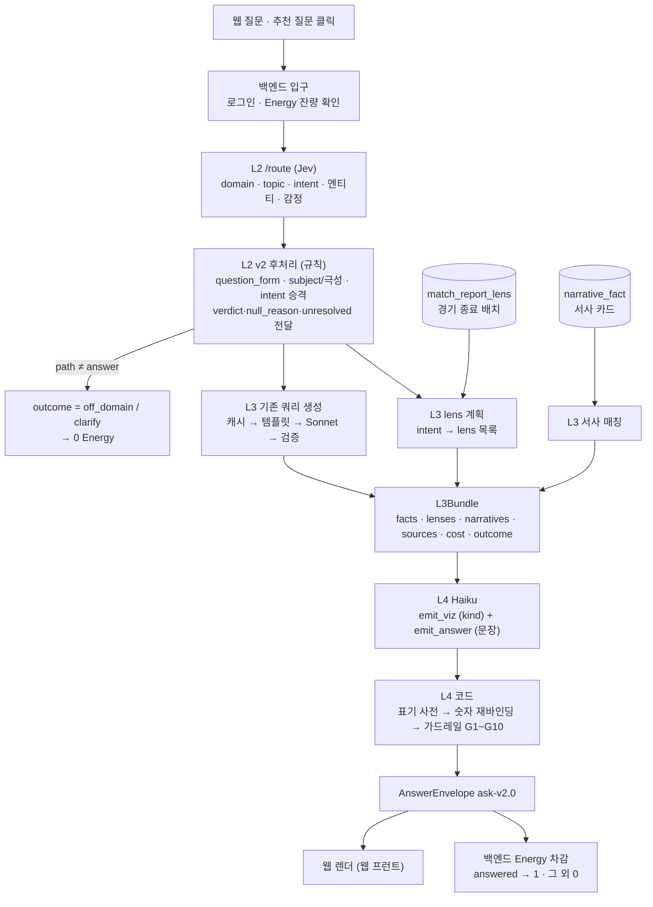

# 00. 전체 흐름 — 목업 ↔ 층

## 목업 블록이 어느 층에서 만들어지나

| 목업 블록 | 봉투 필드 | 만드는 층 | 값의 출처 | LLM 관여 |
|---|---|---|---|---|
| ① 결론 한 줄 | `lead.text` · `lead.sub` | L4 | Haiku 문장 + 가드레일 G1·G2·G3·G5 | 문장만 |
| Ⓗ 역대 맥락 | `history[]` | L3 | `narrative_fact` 카드 문장 그대로 | 없음 |
| ② 사실 카드 | `facts{kind, rows, meta}` | L3 → L4 | L3 쿼리 결과 · 기존 emit_viz kind | kind 선택만 |
| ③ RORR 분석 | `lenses[]` | L3 (+L4 한 줄) | `match_report_lens`(배치) · 그래프/시계열 쿼리 | insight 한 줄만 |
| ④ 근거 칩 | `evidence[]` | L3 | lens sources | 없음 |
| ④ 서하 반응 | (봉투에 없음) | 페르소나 경로 | 웹과 Extension 이 같이 켜졌을 때 SD 서하가 덧붙이는 별도 Muse 메시지 · G8 (D-025 · D-026) | 없음 — L4 Haiku 는 쓰지 않는다 |
| ④ 후속 질문 | `next[]{text, energy}` | L4 | Haiku 문장, 비용은 코드 | 문장만 |
| 헤더 잔량 · 차감 | `energy{cost, charged, reason}` | 백엔드 | `L3Bundle.outcome` + 진입 경로 | 없음 |
| "2026 데이터 기준" | `data_scope_label` | L3 → L4 | `L3Bundle.data_scope` | 없음 |

## 흐름

## 원가 구조 (질문 1건, 판매가 ₩120)

| 경로 | L2 (Jev) | L3 | L4 (Haiku) | 합계 |
|---|---|---|---|---|
| 해설형 · 배치 lens만 (Q1 경기 해설) | ≈ ₩0.3 | ₩0 (키 조회) | ≈ ₩0.6~3 | **≈ ₩1~4** |
| 선수 해설 · LwRC+ 캐시 (Q2) | ≈ ₩0.3 | ₩0 | ≈ ₩0.6~3 | **≈ ₩1~4** |
| 관계 해설 · 쿼리 신규 생성 (Q3) | ≈ ₩0.3 | 평균 ₩41 · 상위 10% ₩177+ | ≈ ₩1.3~3 | **≈ ₩42~** (두 번째부터 캐시 ₩0) |

출처: [L2] 인텐트 추출 테스트 정리(Jev $0.0002/건) · [L3] 쏘넷 5.5 비용 · L4 하이쿠 비용 계산.
→ **해설형 답일수록 배치·캐시로 원가가 0에 가깝게 내려가는 구조**가 v2의 경제성 핵심이다.

## 질문 3개로 본 경로 (목업)

| 목업 질문 | L2 결과 | L3 lens | 서사 |
|---|---|---|---|
| T1, BLG 4세트 왜 졌어? | team_form → **match_review** (why + 경기 맥락) · 주어 T1 · loss | winprob_curve · objective_swing · death_breakdown (배치) | T1 × LPL · Worlds |
| 페이커 이번 Worlds 폼 어때? | player_stat → **player_form** (how) · 주어 Faker | lwrc_by_game · lwrc_cdr (LwRC+ 캐시) | — |
| T1은 BLG 상대로 왜 약해? | team_record → **matchup_pattern** (why) · 주어 T1 | gold_diff_by_minute · first_objective_rate · role_matchup (쿼리) | T1 × LPL · Worlds |
