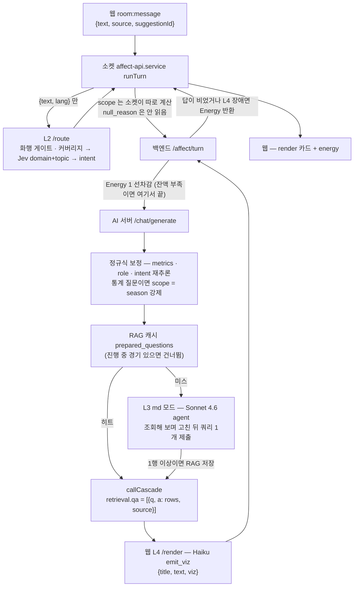

# 05. 지금 → 목업 수준 — 층별 동작과 필요한 변화

Ask RORR(rorr.club 웹 질의응답)이 목업 수준의 답을 내려면 각 층이 **어떻게 움직여야 하고**, **지금 코드에서 무엇이 바뀌어야 하는지**를 한 장에 모은다.
층별 상세 설계는 `01~04` 문서, 이 문서는 실서비스 코드를 읽고 쓴 **현황 대조**다.

대조한 코드 (2026-11-18, `rorr-repos/` 클론):

| 레포 (`piecomp/`) | 브랜치 · 커밋 | 이 문서에서의 역할 |
|---|---|---|
| `rorr-socket-server` | `dev` `f66dd26` | 입구 — 웹 질문 수신 · L2 호출 · scope |
| `rorr-user-intent-router` | `prod` `4218e90` | L2 — Jev 판정 `/route` |
| `rorr-backend-api-v2` | `dev` `5830d9c` | 백엔드 — Energy 차감 · AI 서버 호출 |
| `rorr-backend-ai` | `dev` `0fa7b22` | L3 — 쿼리 생성 · 실행 · L4 호출 |
| `rorr-ask-renderer` | `dev` `9e8ebe7` | L4 — 정형화 (AI 서버와 같은 컨테이너) |

> 코드를 읽어서 쓴 내용이다. 실제 요청을 보내 확인한 것은 아니다 — "확인 필요" 표시는 운영 로그로 다시 봐야 한다.

## 1. 한눈에 — 목업 블록별 지금 상태

| 목업 블록 | 지금 | 막힌 곳 |
|---|---|---|
| ① 결론 한 줄 (주어 관점) | △ `text` 상세 답변이 있으나 주어·승패 관점을 모른다 | L2 가 주어·극성을 안 잡는다 → L4 입력에 없다 |
| Ⓗ 역대 맥락 | ❌ 없음 | 서사 카드 테이블 · 조회 · 전달 자리 모두 없음 |
| ② 사실 카드 | ✅ `card` · `ranking` · `compare` + 폴백 `table` · `text` | — |
| ③ RORR 분석 (lens 3종) | ❌ 없음 — 분석 뷰를 조회하더라도 **표 1개**로 나온다 | L3 가 쿼리 1개만 제출 · L3 → L4 가 결과 1묶음(`qa[0]`)만 전달 |
| ④ 근거 칩 | ❌ 없음 (`source` 는 `postgres`/`neo4j` 이름뿐) | 위와 같음 |
| ④ 서하 반응 | ❌ 웹은 캐릭터·표현층을 건너뛴다 | 웹 L4 에 서하 문장 도구 없음 |
| ④ 후속 질문 (⚡ 표시) | ❌ 없음 — 추천 질문 칩(운영자 지정)만 있다 | L4 가 후속 질문을 만들지 않는다 |
| Energy 영수증 | △ `energy{charged, balance}` 는 온다 | 차감 사유 · "답 못 하면 0" 규칙이 다르다 (§6) |
| "2026 데이터 기준" | ❌ 없음 | L3 가 데이터 범위를 알리지 않는다 |

**핵심 한 줄:** 지금 구조는 "질문 → 쿼리 1개 → 결과 1묶음 → 카드 1장"이다. 목업은 "질문 → 사실 + 분석 3종 + 역대 맥락 → 여러 블록"이다.
그래서 가장 큰 변화는 **L3 → L4 사이 전달 구조**(결과 1묶음 → 묶음 여러 개)이고, L2·L4 변경은 그 위에 얹힌다.

## 2. 지금의 실제 흐름 (웹 직접 질문)

## 3. L2 — 의도 판정 (`rorr-user-intent-router` + 소켓)

### 지금 움직이는 방식

- **판정**: 화행 게이트 · 커버리지(코드 규칙) → Jev 에 domain+topic 을 한 요청으로 → 그 topic 안에서 intent. intent 가 none 이면 2순위 topic 으로 1회 재시도 (`jev.py judge_route`).
- **계약 8키**: `path · domain · topic · intent · null_reason · verdict · slots{entity_type, entities, entity_refs, unresolved, metrics} · emotion` (`router.py CONTRACT_KEYS`).
- **intent 35종 · topic 6종** (`data/labels.json` `2026-10-07-35`). `team_compare` 는 이미 있다. `analysis` topic 에 `match_review` · `player_review` · `teamfight_analysis` · `turning_point` 가 있다.
- **입력은 `{text, lang}` 뿐**이다. 소켓이 대화 기록 · 보고 있는 페이지를 보내지 않는다.
- **scope 는 두 곳에서 따로 만든다.** 라우터 `scope.py` 는 사전(`gazetteer.json`)으로 뽑지만 **계약에 싣지 않는다**. 소켓 `scope.service.ts` 는 자기 어휘 목록으로 다시 정한다. 우선순위도 다르다 (라우터 patch → season → day → match → live, 소켓 live → day → match → patch → season). 그 뒤 AI 서버가 통계 질문이면 season 으로 또 덮어쓴다.
- **필드 전달**: 소켓은 `intent · verdict · path · unresolved · entity_refs · metrics · domain · topic · scope` 를 백엔드로 넘긴다. **`null_reason` 은 소켓이 안 읽는다.** 백엔드는 AI 서버로 넘길 때 **`verdict · path · unresolved` 를 버린다** (`affect.controller.ts`).

### 목업 수준이 되려면

| 필요한 동작 | 지금 | 바꿀 곳 |
|---|---|---|
| 질문의 **주어**와 **승패 관점** — "T1 왜 졌어?" 에 T1 관점으로 답 | 없음 | 라우터 `/route` 응답 직전에 규칙 모듈 추가 (`l2/question.py` `subject_of` · `polarity`). 계약에 `question_form` · `subject{…, polarity}` 추가 (`contracts/l2_route_v2.schema.json`) |
| **'왜 · 어때'** 를 해설형으로 인식 | Jev 가 `team_form` · `team_record` 등 사실형으로 판정하기 쉽다 | 같은 자리에서 `upgrade_intent` (Jev 프롬프트는 그대로) |
| "왜 약해?" 류 intent | 35종에 없음 | `matchup_pattern` 추가 — `data/labels.json` 과 `l2/intents.py` 를 같이 |
| scope 한 곳에서 | 3곳 (라우터 · 소켓 · AI 서버) | 라우터가 계약에 `scope` 를 싣고 소켓 `scope.service.ts` 어휘 목록 삭제. AI 서버의 season 강제는 L3 프롬프트 규칙으로 (D-005) |
| 판정 근거를 L3 까지 | `null_reason` 은 소켓에서, `verdict · path · unresolved` 는 백엔드에서 끊긴다 | 소켓 `RouteContract` 에 `null_reason` 추가 · 백엔드 `/chat/generate` 본문에 4개 필드 추가 · AI 서버 `GenerateRequest` 에 자리 추가 |
| 페이지 맥락 (선수 페이지에서 "폼 어때?") | 없음 | 웹 → 소켓 `room:message` 에 `context{page, entity}` → `/route` 요청에 전달 |

기준 코드와 어긋나는 점 하나: `l2/intents.py` 의 `team_champions` 는 라우터 35종에 없다. 지울지 라우터에 추가할지 정해야 한다 (D-002 후속).

## 4. L3 — 컨텍스트 조립 (`rorr-backend-ai`)

### 지금 움직이는 방식

- **운영 · 개발 모두 `md` 모드**다 (`deploy-prod.yml` · `deploy-dev.yml`): `L3_PROMPT_MODE=md` · `L3_QUERY_MODEL=claude-sonnet-4-6` · `L3_GEN_MODE=agent`. 문서에 적었던 "Sonnet 5.5 · 아직 이관 전" 은 지금 코드와 다르다.
- **agent 방식**: 모델이 `sql_query` · `graph_query` 로 직접 조회해 보고 고친 뒤 `submit_query` 로 **쿼리 1개**를 제출한다. 한도는 10턴 · 25초, 요청 전체는 42초 (`l3-query.service.ts`, `env.ts`).
- **앞 단계**: `generate()` 가 정규식으로 metrics · role · intent 를 다시 추론하고 (L2 가 비운 경우 보정), 선수/팀 + 통계 지표면 scope 를 season 으로 바꾼다.
- **캐시**: RAG(`prepared_questions`) 를 먼저 본다. 진행 중 경기가 있으면 건너뛴다. 생성한 쿼리는 **1행 이상이면 저장한다** — 코드 주석도 "값을 직접 써서 다른 선수·팀 질문에 히트되면 틀릴 수 있음 (테스트용으로 감수)" 라고 적는다 (D-019).
- **정적 템플릿 45개는 꺼져 있다** (2026-11-04, 엔티티 없는 질문에 엉뚱한 답). 추천 질문 칩만 이름 붙은 템플릿으로 바로 답한다.
- **분석 뷰는 이미 프롬프트에 있다**: `win_probability_frame` · `v_objective_swing` · `v_kill_damage_breakdown` · `wge_player_game` · `obj_intensity_weight` (`src/chat/l3/prompts/routing.md` · `examples.md`). 그래서 "왜 졌어?" 에도 이 뷰를 조회할 수는 있다 — 다만 결과가 **표 1개**다.
- **L4 로 넘기는 것**: `callCascade` 가 만드는 `GenRequest`. 데이터는 `retrieval.qa = [{q, a: rows, source}]` 하나뿐이다. domain 이 common 이면 `qa = []`.

### 목업 수준이 되려면

| 필요한 동작 | 지금 | 바꿀 곳 |
|---|---|---|
| 한 질문에 **사실 + 분석 여러 종** | 쿼리 1개 · 결과 1묶음 | `generate()` 에서 쿼리 실행 뒤 · `callCascade` 앞에 `plan_lenses` → `assemble` (`l3/lenses.py` · `l3/bundle.py`). 기존 쿼리 생성은 그대로 '사실' 을 맡는다 |
| 분석 값이 **매번 같고 빠르고 싸게** | 매 질문마다 agent 가 최대 25초 탐색 · 결과가 질문마다 달라질 수 있다 | 경기 종료 배치 `match_report_lens` (`l3/match_report.py` · `sql/001`). 질문 시점엔 `(game_id, subject_side)` 로 읽기만 |
| 분석을 **주어 팀 기준 부호**로 | 블루 기준 (`win_prob_100`) 그대로 | 배치가 팀별 1행씩 미리 뒤집어 저장 |
| **역대 맥락** | 없음 | `narrative_fact` 테이블 + `NarrativeStore.match` (`l3/narrative.py` · `sql/002`) — 같은 자리에서 조회 |
| L4 에 **여러 묶음 · 주어 · 결과 상태** 전달 | `qa[0]` 하나 | `callCascade` 의 `body` 조립부에 `retrieval.lenses[]` · `retrieval.narratives[]` · 최상위 `route{question_form, subject…}` · `outcome` · `data_scope` 추가. 없으면 현행 동작 (D-016 — 이제 코드를 볼 수 있어 확정 가능) |
| **답을 냈는지 상태** (`outcome`) | 없음 — 백엔드는 `text` 가 비었는지만 본다 | `GenerateResponse` 에 `outcome` 추가 (`answered · no_data · l3_failed · off_domain · clarify · system_error`) |
| 캐시가 다른 대상에 재사용되지 않게 | 값이 박힌 쿼리를 저장 | lens 는 배치 키 조회라 캐시가 필요 없다. 쿼리형 lens 는 엔티티를 파라미터로 분리한 뒤에만 저장 (D-019) |

배치를 붙일 곳(경기 종료 이벤트 컨슈머)은 받은 레포 6개에서 아직 찾지 못했다 — 데이터센터 쪽 레포일 가능성이 높다.

## 5. L4 — 정형화 (`rorr-ask-renderer`)

### 지금 움직이는 방식

- AI 서버와 **같은 컨테이너**에서 돈다 (`start.sh`, 127.0.0.1:8001). 배포 설정상 모델은 **Haiku 4.5** 다 (`BEDROCK_MODEL_ID` — 렌더러 코드 기본값은 Haiku 5.5).
- `POST /render` → `to_l3()` 가 `intent.type` · `retrieval.qa[0].{q, a}` · `meta.lang` 만 꺼낸다 → Haiku `emit_viz` 1회 → `{title, text, viz}`.
- kind 는 데이터 모양 3종(`card` · `ranking` · `compare`) + 코드 폴백 `table` · `text`. intent 는 힌트일 뿐이다.
- 데이터가 없으면 모델을 부르지 않고 "관련 데이터가 없어요" `text` 카드를 낸다.
- 코드 안전벨트: `fillable` · `numbers_grounded`(구조 값만) · `_downgrade`. 표 셀은 시간 ms → 분:초, 진영 100/200 → 블루/레드, `wge` → `LwRC` 로 바꾼다. **`text` 프로즈는 프롬프트 규칙으로만 통제된다.**

### 목업 수준이 되려면

| 필요한 동작 | 지금 | 바꿀 곳 |
|---|---|---|
| 결론이 **주어 관점** ("T1은 …에서 갈렸어요") | 주어를 모른다 — faker 로그 "네, BLG는 이겼어요" | `to_l3()` 가 `route.subject` 를 읽고, 가드레일 G1 로 검사 · 틀리면 템플릿 결론으로 교체 (`l4/guardrails.py`) |
| `text` 에 **raw 값이 안 나온다** (1395635초 · 100 측) | 표 셀만 변환 | `formalize()` 가 draft 를 받은 직후 `normalize_text` + G2 · G3 · G7 (`l4/glossary.py`). **L3 변경 없이 지금 바로 넣을 수 있다** |
| "최근 5경기" 와 표 행 수가 맞는다 | 프롬프트 규칙만 | G5 코드 검사 — 이것도 지금 바로 가능 |
| 분석 카드마다 **지표 이름 · 기준** | 컬럼 라벨 사전만 | `METRICS` 사전 새 모듈 + lens 마다 `metric_label · metric_basis · unit` |
| **lens 별 한 줄 해석 · 서하 반응 · 후속 질문** | 없음 | `prompts.py` 에 `emit_answer` 도구 추가 (또는 `emit_viz` 확장 — D-008). 숫자는 L3 값에 다시 묶는다 |
| **역대 맥락은 카드 문장 그대로** | 없음 | LLM 을 거치지 않고 봉투 `history[]` 로 통과 + G9 |
| 봉투 **ask-v2.0** | `{title, text, viz}` | `app.py render()` 응답 조립. 기존 웹이 깨지지 않게 `viz` 는 그대로 두고 새 필드를 덧붙인다 (D-015) |

현행 규칙과 부딪히는 3건(표 전 행 ↔ 10행 접기 · 블루/레드 ↔ 팀 코드 · `text` 숫자 인용)은 D-017 그대로다.

## 6. Energy — 백엔드 (`rorr-backend-api-v2`)

### 지금 움직이는 방식 (`affect.controller.ts` · `payment.service.ts`)

- 웹 직접 질문은 **AI 호출 전에 1 을 먼저 뺀다.** 잔액이 모자라면 AI 를 부르지 않고 `NOT_ENOUGH_BALANCE`.
- 추천 질문 칩(`suggestionId` 가 `ask_suggestions` 에 있음)은 무료 — 확인이 실패해도 무료.
- **돌려주는 경우는 둘**: 답 `text` 가 비었을 때 · 엔진이 `l4-web-fallback`(웹 L4 장애 안내 카드)일 때.
- 응답에 `energy{charged, balance}`, 실패면 `error{code}` (`NOT_ENOUGH_BALANCE` · `ENERGY_FAILED` · `AI_FAILED`).

### 기준(`docs/04`)과 다른 점

| 상황 | 기준 | 지금 (코드상) |
|---|---|---|
| 답변 완료 | 1 | 1 ✅ |
| AI 실패 · 타임아웃 · L4 장애 | 0 | 0 ✅ (선차감 후 반환) |
| **데이터 없음** ("관련 데이터가 없어요" 카드) | 0 | **1 로 읽힌다** — `text` 가 있고 엔진이 `l4-web` 이라 반환 조건에 안 걸린다. 확인 필요 |
| **롤 밖 질문** (`domain = common`) | 0 | **1 로 읽힌다** — `qa = []` → 같은 안내 카드. 확인 필요 |
| 되묻기 | 0 | 되묻기 경로를 찾지 못했다 (L3 agent 프롬프트는 "되묻지 말고" 로 고정) |
| 답변 안 탭 · 근거 · 다시 보기 | 0 | 진입 경로가 `typed` · `suggested` 둘뿐이다 (추천 칩만 무료) |
| 차감 시점 | 봉투 전송 뒤 | 호출 전 선차감 + 실패 시 반환 — 결과는 같지만 화면 문구("답변 완료 후 차감")와 순서가 다르다 |

바꿀 곳: AI 서버가 응답에 `outcome` 을 싣고, 백엔드의 반환 조건을 `!text || engine === 'l4-web-fallback'` 에서 **`outcome !== 'answered'`** 로 바꾼다 (`energy.py` 규칙). 응답 `energy` 에 `reason` 추가.
선차감 방식 자체는 유지해도 된다 — 동시 질문으로 잔액이 음수가 되는 것을 막는 구조다.

## 7. 바꾸는 순서

앞 단계일수록 다른 층을 기다리지 않는다.

| 단계 | 무엇 | 레포 | 다른 층 의존 | 화면에서 달라지는 것 |
|---|---|---|---|---|
| **A. 지금 바로** | `text` 프로즈 가드레일 (G2 · G3 · G5 · G7 · `normalize_text`) | `rorr-ask-renderer` | 없음 | "1395635초" · "100 측" · 행 수 불일치가 사라진다 |
| | `outcome` + Energy 반환 조건 | `rorr-backend-ai` · `rorr-backend-api-v2` | 없음 | 데이터 없음 · 롤 밖 질문이 무료가 된다 |
| **B. L2 관점** | `question_form` · `subject` · intent 승격 · `null_reason` 등 전달 | 라우터 · 소켓 · 백엔드 · AI 서버 | 계약 필드 추가 (4개 레포 동시) | "졌어?" 에 주어 관점으로 답한다 (G1) |
| | scope 단일화 | 라우터 · 소켓 | D-005 확정 | — (오답 감소) |
| **C. L3 묶음** | 경기 종료 배치 `match_report_lens` · `narrative_fact` · `GenRequest` 확장 | `rorr-backend-ai` + 배치 컨슈머 (레포 미확인) | D-016 · D-018 · D-019 | 아직 없음 (L4 가 읽어야 보인다) |
| **D. L4 해설** | `emit_answer` · 봉투 ask-v2.0 · `METRICS` | `rorr-ask-renderer` | C 가 먼저 · D-008 · D-015 · D-017 | 결론 · 역대 맥락 · RORR 분석 · 서하 · 후속 질문 블록 |
| **E. 웹** | v2 봉투 렌더 · Energy 영수증 | 웹 프런트 (레포 미확인) | D 가 먼저 | 목업 화면 |

A 는 계약을 건드리지 않아 L4 · 백엔드 담당이 각자 바로 할 수 있다. B~D 는 `GenRequest` 와 `/route` 계약이 같이 바뀌므로 `contracts/*.schema.json` 을 먼저 확정한 뒤 들어간다 (D-004).

## 8. 아직 모르는 것

- **웹 프런트 레포** — v2 봉투를 그릴 곳. 받은 6개 레포에 없다.
- **경기 종료 배치를 붙일 컨슈머** — 6개 레포에 없다.
- **현재 원가** — `docs/00` 의 평균 ₩41 은 Sonnet 5.5 단발 생성 기준 측정값이다. 운영은 Sonnet 4.6 agent(여러 턴)라 다시 재야 한다 (`query_cost` 로그에 호출 수 · 비용이 남는다).
- **Energy 가 데이터 없음 · 롤 밖 질문에 실제로 차감되는지** — §6 은 코드를 읽은 결과다.
- **`rorr-ollama-server`** — Extension 용 캐릭터 대사(GPU 서버)로 보이며 웹 경로에는 안 쓰인다. 내용은 읽지 않았다.
