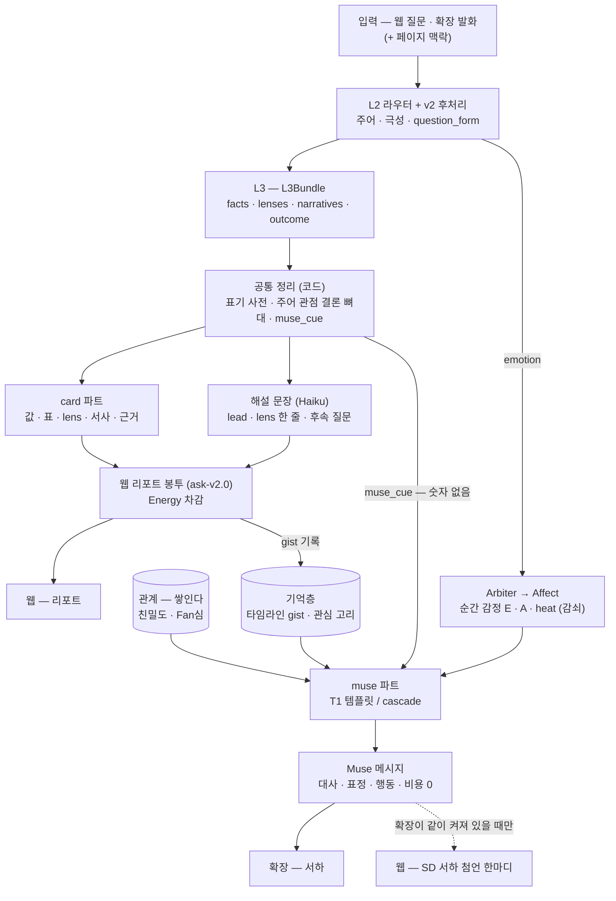

# 06. 채널 전체 방향 — 웹 Ask RORR · 익스텐션 Muse(서하) · Overlay

`00~05` 는 웹 Ask RORR 답변만 다뤘다. 이 문서는 Muse 쪽 설계(감정 엔진 · Fan심 · 친밀도 · 기억 · 선발화)와 3채널 UX 원칙을 같이 놓고, **층 구조가 두 채널을 함께 감당하려면 무엇이 달라져야 하는지**를 정리한다.

읽은 원본 (2026-11-18, 링크는 `docs/sources.md`):

| 문서 | 무엇을 정하나 | 상태 |
|---|---|---|
| Muse 대화 시스템 레이어 구조 (허브) | 5계층 · Arbiter · Affect Engine | 구현 기준 (2026-10-13 갱신) |
| L4 표현·변주 레이어 — 동작 흐름 | 익스텐션 L4 (qwen3:14b · 캐릭터 카드 4축 · 규칙 검증) | 구현 기준 |
| 대화 레이어 구조 구성 (Web/Extension 소스 증가) | 입력 게이트웨이 · 기억층 · 선발화 · 응답 봉투 `muse · card · overlay` | 논의용 초안 (태스크는 Done) |
| 정보·감정 전달 3채널 UX 원칙 | Overlay · Muse · 온톨로지 검색 채널 구분 | 채택 |
| Muse - 발화 | 관전 포인트 선발화 · 문자 중계 페이지 | 기능 명세 (TODO) |
| 친밀도 단계 · Fan심 - Draft | 관계 축 2개 · 점수 · 단계 | 초안 |
| Muse - 대화 History | 맥락 기억 세 영역 (공통 · Muse↔유저 · Ask RORR↔유저) | 초안 — 2026-11-18 이 작업에서 작성 (§7-1) |

실서비스 코드는 `rorr-repos/` 를 읽어 대조했다. 실제 요청으로 확인한 것은 아니다.

> **기준은 기능 명세서다 (D-032).** 지금 코드는 임시 구현이므로, 아래 표의 '지금 코드' 는 현황일 뿐이고 명세와 다르면 명세 쪽으로 맞춘다. 그래서 서하 수치 금지(D-027)는 명세 쪽으로 방향이 정해졌다. 감정과 친밀도는 서로 다른 개념이다 (D-028, §7).
>
> **봉투란** — 질문 한 번에 서버가 화면으로 돌려보내는 응답 JSON 한 덩어리. 화면은 이 안에 있는 것만 그린다. 지금은 `{title, text, viz}` 이고, 이 레포의 목표 모양이 `contracts/answer_envelope.schema.json` (ask-v2.0)이다.

## 1. 결론

1. **층 구조(L2 → L3 → L4)는 그대로 쓴다.** 두 채널이 갈라지는 곳은 L4 하나이고, 실서비스도 이미 그렇게 돼 있다 (`rorr-backend-ai` `chat.service.ts` `callCascade` 의 `channel` 분기).
2. **봉투는 플랫폼별로 묶는다 (Jun, 2026-11-18 — 비용 기준, §4-1).** 웹은 Energy 를 받고 온톨로지 리포트를 주는 곳이고, 확장은 비용이 들지 않는 감정선에서 답하는 곳이다. 그래서 `AnswerEnvelope ask-v2.0` 은 **웹 리포트 봉투**이고 서하 대사는 여기에 넣지 않는다. 10/23 초안의 '한 봉투에 `muse · card · overlay`' 는 따르지 않는다.
3. **한 턴에 목소리가 셋이다 — 섞으면 안 된다.** 카드(값, 코드) · 해설 문장(분석가 말투, Haiku) · 서하 대사(감정, 페르소나 경로). 지금 기준 코드는 서하 대사를 Haiku `emit_answer` 에 같이 넣어 놨는데, 이건 옮겨야 한다 (§4).
4. **개인화 재료(감정 · Fan심 · 친밀도 · 기억)는 `muse` 파트에만 들어간다.** `card` 와 해설 문장은 유저가 누구든 같아야 캐시를 나눠 쓸 수 있다 — 초안의 "공유하는 건 사실, 개인화하는 건 말투".
5. **경기 종료 배치(`match_report_lens`)는 Ask RORR 만의 것이 아니다.** 선발화의 관전 포인트 · 문자 중계 · 경기 총평이 같은 계산을 쓴다 (§6).

> 앞선 검토에서 "익스텐션에서는 서하가 답 자체라 숫자를 말해야 한다"고 봤는데, 3채널 원칙은 반대로 정해 놨다 — 유저가 직접 물어도 서하는 느낌으로 답하고 가리키며, 수치는 카드가 맡는다. 어긋나는 쪽은 원칙이 아니라 **현행 익스텐션 L4** 다 (§5).

## 2. 채널이 맡는 일 (3채널 원칙 + 10/23 초안 §0)

| 서피스 | 채널 | 방식 | 유저가 받는 것 | 받는 파트 |
|---|---|---|---|---|
| 웹 rorr.club/chat | ③ 온톨로지 — 깊은 정보 | Pull · 수 초 허용 · Energy | 리포트(수치 · 그래프 · 근거). 확장이 같이 켜져 있으면 SD 서하 첨언 | 웹 리포트 봉투 (+ Muse 메시지) |
| Chrome 확장 | ② Muse — 감정 · 응원 | Push · 표정은 매 턴, 대사는 상황이 열릴 때 · 비용 0 | 대사 · 표정 · 행동 · 선발화 | Muse 메시지 |
| Overlay | ① 상시 정보 | Ambient · 아무도 말하지 않음 | 지표 펄스 · 카운터 · 게이지 | 지표 브로드캐스트 |

원칙 한 줄: **정보는 공간에, 감정은 서하에게.** 서하 대사에 숫자 · 지표명 금지, Boost · 충전 권유 금지.
이 레포의 G8 과 `docs/04` 의 no_dependency 규칙이 이 원칙에서 온 것이다.

## 3. 층별 지도 — 명세 · 지금 코드 · 이 레포

| 층 | 명세가 정한 것 | 지금 코드 | 이 레포 | 간극 |
|---|---|---|---|---|
| 0. 입력 | 세 서피스 공통 입력 계약 (`surface` · `kind` · `context`) · presence · 유저별 직렬화 | 소켓 `room:message` + REST `ask` 두 길. `channel` = `web` · `extension` · `overlay` | 없음 | 웹 페이지 맥락(`context.page`)이 L2 로 안 간다 (`docs/05` §3) |
| 1. 소스 | Riot · 온톨로지 · 캐릭터 설정 · 대화 기록 · Fan심 | 있음 | — | — |
| 2. L2 라우터 | 계약 8필드 · 서피스 무관 · 맥락은 슬롯 기본값 | `rorr-user-intent-router` | `l2/` — 주어 · 극성 · intent 승격 | 주어 · 극성은 **두 채널 다** 필요하다. "네, BLG는 이겼어요"는 서하도 똑같이 낸다 |
| 2. Arbiter · Affect | 자극 선택 · salience · heat → E · A 적분. LLM 0. 성격 Config 주입 | `rorr-backend-api-v2` `src/modules/affect/` (`arbiter.service.ts` · `affect.service.ts`). 상태 키는 이미 유저 × 캐릭터 (`user_relation`). **웹은 건너뛴다** (`WEB_NEUTRAL_STATE`) | 없음 | 웹 질문이 서하의 감정 · 관계에 아무 흔적도 안 남긴다. 허브 문서의 서버 매핑(소켓)은 코드와 다르다 |
| 2. 관계 뷰 | 친밀도 L0~L4 (유저와 Muse 사이에 **쌓여 가는** 값 — 감정과 별개) · Fan심 5티어 | `fanTier` · `fanFactor` 가 salience 에 곱해진다. `user_relation.intimacy` 는 감정 상태(E · A · heat)와 같은 줄에서 턴마다 감쇠하는 값이라 명세의 친밀도로 읽으면 안 된다 | 없음 | 쌓이는 친밀도(점수 · L0~L4)를 담는 자리를 코드에서 찾지 못했다 (§7) |
| M. 기억 | 작업 기억(관심 고리) · 대화 타임라인(`surface` 꼬리표 · `gist`) · 장기 기억 | 방(room) 메시지 최근 10턴. REST `ask` 는 `history: []` | 없음 | 타임라인 · 관심 고리 · gist 를 코드에서 찾지 못했다. 서피스 간 공유 없음 |
| 3. L3 조립 | 조회 + 이력 3겹 + GenRequest. 조회 결과를 card 데이터로도 반환 | 쿼리 1개 → `retrieval.qa[0]` | `l3/` — lens · 서사 카드 · `L3Bundle` | `L3Bundle` 에 **서하에게 줄 숫자 없는 재료**가 없다 (§4) |
| 4. 생성 | 응답 봉투 `muse · card · overlay`. T1 템플릿 · T2 qwen3. 서하 대사에 숫자가 들어갈 자리가 구조적으로 없다 | 웹: `rorr-ask-renderer` Haiku → `{title, text, viz}`. 확장: `rorr-ollama-server` qwen3:14b 가 원본 행을 읽고 **수치까지 말한다** | `l4/` — 봉투 · 가드레일 · `emit_answer` | 봉투가 파트로 나뉘어 있지 않다. 서하 대사를 Haiku 가 쓴다 |
| 5. 표현 | 채널 → 서피스 매핑 · 팬아웃 (요청 서피스 = 본 답, 나머지 = 반향) | 요청한 서피스에만 답 | — | 웹에서 물어도 확장의 서하는 모른다 |
| 선발화 | Arbiter 자발 발화 → T1 템플릿. 관전 포인트 · callback · 휴지기 · 복귀 인사 | 경기 이벤트 → 유저별 감정 팬아웃은 있다 (`game-event/kafka-consumer.service.ts`). 대사를 만드는 호출은 찾지 못했다 | 없음 | 관전 포인트 감지 엔진 없음 |

## 4. 한 턴의 산출물 — 파트 셋, 목소리 셋



### 4-1. 플랫폼별 봉투 (2026-11-18 수정)

| | 웹 Ask RORR | 확장 Muse |
|---|---|---|
| 유저가 내는 것 | Energy 1 | 없음 |
| 받는 것 | 온톨로지 리포트 — 결론 · 역대 맥락 · 사실 · RORR 분석 · 근거 | 서하의 감정 반응 — 대사 · 표정 · 행동 |
| 봉투 | **웹 리포트 봉투** (ask-v2.0, `muse` 필드 없음) | **Muse 메시지** (지금의 `room:message`) |
| 드는 비용 | L2 + L3(배치 · 캐시면 0, 쿼리 생성이면 큼) + L4 Haiku | L2 + Arbiter · Affect(LLM 0) + 대사 |
| L3 쿼리 | **깊게** — 사실 쿼리 + 분석 lens 3종 이상 + 역대 맥락 | **얕게** — 쿼리 1개, 더 싼 모델 (§4-2) |

**웹의 SD 서하 첨언**

- 리포트 봉투의 일부가 아니다. 리포트가 나간 뒤 **따로 오는 Muse 메시지**다 (10/23 초안 §7 팬아웃의 '반향').
- **확장이 같이 켜져 있을 때만** 보낸다 — presence 로 판단. 확장이 없으면 웹은 리포트만 그린다.
- 재료는 리포트를 만들 때 같이 나온 숫자 없는 `muse_cue` 다. T1 템플릿이면 추가 비용이 0 이고, 리포트 캐시도 유저별로 쪼개지지 않는다.
- Energy 는 리포트 값이다. 첨언은 과금 대상이 아니고, 첨언이 실패해도 리포트와 차감에 영향이 없어야 한다.

**확장에서 데이터 질문이 오면** ("왜 밀리는 거야?")

- 서하는 느낌으로 답하고 가리킨다 (3채널 원칙). 재료는 `muse_cue` — 배치 · 캐시 · 얕은 조회(§4-2)에서 나오면 방향을 말하고, 없으면 감정 호응만.
- 깊은 답은 웹 리포트로 넘긴다 (질문을 채운 링크 — Energy 는 웹에서, 유저가 눌렀을 때만). 서하가 권유하는 말투가 되면 no_dependency 에 걸리므로 문구는 정해야 한다 (D-033).

| 목소리 | 내용 | 누가 만드나 | 유저마다 다른가 | 캐시 |
|---|---|---|---|---|
| **카드** | 값 · 표 · lens 그래프 · 역대 맥락 · 근거 | 코드 (L3 값 그대로) | 같다 | 엔티티 · scope · 데이터 버전 |
| **해설 문장** | 결론 한 줄 · lens 한 줄 해석 · 후속 질문 | Haiku + 숫자 재바인딩 · 가드레일 | 같다 | 카드와 같은 키 |
| **서하 대사** | 반응 · 응원 · 가리킴 ("아까부터 골드가 쭉 빠지고 있어… 불안해") | 페르소나 경로 — 짧으면 T1 템플릿, 자유 대화는 qwen3 | **다르다** (친밀도 말투 · Fan심 · 순간 감정 · 기억) | 템플릿 뱅크만 |

**서하 대사를 Haiku `emit_answer` 에서 빼야 하는 이유**

- Haiku 는 친밀도 · Fan심 · 감정 상태를 받지 않는다. 받게 하면 해설 문장까지 유저마다 달라져 캐시를 못 나눈다.
- 확장의 서하는 qwen3 + 캐릭터 카드로 말한다. 웹의 서하를 다른 모델 · 다른 프롬프트가 쓰면 같은 캐릭터가 두 말투가 된다.
- 웹의 서하는 한 줄 반응이라 T1 템플릿(극성 × 감정 코드 × 친밀도 단계)으로 충분하다 — LLM 0, 숫자가 들어갈 자리가 없어 G8 을 구조로 지킨다.

**`muse_cue` — L3 가 서하에게 넘기는 숫자 없는 재료 (D-035 · `contracts/muse_cue.schema.json` · `l3/muse_cue.py`)**

목업 Q1("T1, BLG 4세트 왜 졌어?")에서 나오는 값 (`python scripts/demo.py --cue`):

```json
{ "outcome": "answered", "polarity": "loss", "question_form": "why",
  "subject": {"id": "…", "display": "T1"}, "counterpart": {"id": "…", "display": "BLG"},
  "turning": "teamfight", "phase": "mid", "trend": "sudden_drop",
  "has_narrative": true, "has_report": true, "ref": "WORLDS2026_SF_T1_BLG_G4" }
```

"T1 이 졌고, 중반 한타 한 번에 확 넘어갔다" 까지만 안다. 판정 규칙과 필드 표는 `docs/02` §5.

**Muse 메시지 — 서하 한마디가 화면으로 가는 모양 (D-035 · `contracts/muse_message.schema.json` · `muse/message.py`)**

```json
{ "version": "muse-v1.0", "kind": "echo", "surface": "web_sd", "tier": "T1",
  "text": "아… T1 그 한타, 나도 보다가 숨 멈췄어.",
  "expression": {"code": "…", "variant": "…"}, "action": {"code": "…"},
  "cue_ref": "WORLDS2026_SF_T1_BLG_G4" }
```

| `kind` | 언제 | `surface` |
|---|---|---|
| `reply` | 확장에서 유저 발화에 답함 | `extension` |
| `echo` | 웹 검색 뒤 SD 서하 첨언 — 확장이 같이 켜져 있을 때만 | `web_sd` |
| `proactive` | 선발화 (§6) | `extension` |

출력 검사 (대사를 누가 썼든 같은 규칙): **M1** 숫자 · 지표명(= G8, 팀 이름 "T1" 의 숫자는 제외) · **M2** 충전 · Boost 권유 · **M3** `echo` 인데 `cue_ref` 없음 · **M4** 웹 SD 가 `echo` 가 아닌 말을 함.
`expression` · `action` 은 Affect Engine 이 정한 값을 그대로 싣는다 (실서비스 `presentation` 모양). 대사를 고르는 템플릿 뱅크는 페르소나 경로 것이라 이 레포에 없다.

값이 아니라 **방향과 종류**만 싣는다. Fan심(주어가 응원 팀인가)과 친밀도는 개인 단계에서 붙인다.
확장에서 유저가 "왜 밀리는 거야?" 라고 물었을 때도 같은 재료로 서하가 느낌을 말하고, `card` 는 패널 하이라이트 · 카드 연결로 나간다.

### 4-2. L3 깊이를 채널별로 나눈다 (Jun 방향, 2026-11-18)

같은 L3 를 쓰되 **얼마나 깊이 조회하느냐**를 채널로 가른다. 10/23 초안의 '서피스별 깊이 정책' 을 구체화한 것이다.

| | 얕은 조회 — 확장 Muse | 깊은 조회 — 웹 리포트 |
|---|---|---|
| 목적 | 서하가 틀린 말을 하지 않을 만큼의 사실 | Energy 값을 하는 '왜' 해설 |
| 쿼리 수 | 1개 | 사실 1개 + lens 3종 이상 + 서사 카드 |
| 순서 | 캐시 → 배치 lens 읽기 → 단발 생성 1회 | 캐시 → 배치 lens → 사실 쿼리 생성 → 쿼리형 lens |
| 생성 모델 | 낮춘다 (Haiku 급 — 측정 후 확정) | 지금 수준 유지 (Sonnet) |
| 생성 방식 | `single` — 한 번 쓰고 끝. 조회해 보며 고치는 agent 없음 | `agent` 또는 `single` + 재시도 |
| 시간 한도 | 짧게 (옛 QueryGen 은 5초) | 지금 25초 · 요청 전체 42초 |
| 실패하면 | 더 비싼 모델로 넘기지 않는다 → 서하가 감정 호응만 | 재시도 뒤 `outcome = l3_failed` → Energy 0 |
| 결과가 가는 곳 | 집계 요약 → `muse_cue` → 서하 대사 | `L3Bundle` → 리포트 봉투 |
| 받는 질문 | 사실형 (스코어 · 일정 · 로스터 · 단순 기록) | 전부. '왜 · 어때' 는 여기서만 |

**웹의 '쿼리 3개 이상' 은 비용이 3배라는 뜻이 아니다.** lens 3종은 대부분 경기 종료 배치를 키로 읽는 것이라 생성 비용이 0 이다 (`docs/00` 원가 표의 Q1 · Q2 경로). 비싼 건 사실 쿼리를 새로 만들 때뿐이다. 값어치는 조회 횟수가 아니라 **분석 묶음**에서 나온다.

**지키면 좋은 것 셋**

1. **확장에서 '왜 · 어때' 질문은 쿼리를 만들지 않는다.** L2 의 `question_form` 으로 가른다 (규칙 기반, D-003). 배치 lens 가 있으면 `muse_cue` 로 방향만 말하고, 깊은 답은 웹으로 넘긴다. 싼 모델로 해설형 쿼리를 만들면 틀릴 확률이 가장 높은 곳에 가장 약한 모델을 쓰게 된다.
2. **캐시는 한쪽으로만 흐른다.** 웹(깊은 조회)이 만든 쿼리는 확장이 재사용해도 된다 — 확장은 캐시 히트면 비용 0 이다. 반대로 확장의 싼 모델이 만든 쿼리를 공유 캐시(`prepared_questions`)에 저장하면 **유료 웹 답변이 그 쿼리를 쓰게 된다.** 저장하지 않거나 등급 꼬리표를 붙여 웹이 안 읽게 한다 (D-019 와 같이).
3. **모델을 낮추기 전에 잰다.** `l3-R-D` 하니스가 모델 · 단계별 정확도와 비용을 잰다 (`stages.json`). 정답셋 183건 중 사실형만 골라 Haiku 급 `single` 로 돌려 보고 정한다. 서하가 숫자를 말하지 않아도 **방향**(이겼다/졌다 · 앞선다/밀린다)이 틀리면 답이 틀린 것이라, 재야 할 것은 방향 정확도다.

**지금 코드에서 걸리는 곳** — `rorr-backend-ai` 의 `L3_QUERY_MODEL` · `L3_GEN_MODE` 는 서버 전체에 하나다 (`src/config/env.ts`). 채널 분기는 L4 에만 있다. `l3-query.service.ts` 가 `req.channel` 을 보고 모델 · 방식 · 시간 한도를 고르게 해야 한다. `single` 방식 코드는 이미 있다.

## 5. 확장(Muse) 쪽 — 원칙과 현행이 어긋나는 곳

| 항목 | 3채널 원칙 · 10/23 초안 | 현행 확장 L4 (L4 동작 흐름 문서 · `rorr-ollama-server`) |
|---|---|---|
| 서하가 수치를 말하나 | 금지 — 느낌으로 답하고 가리킨다 | 말한다 — "T1이 2대1로 이겼어", 숫자 교정 규칙까지 있다 |
| 깊은 정보 | 검색 채널(카드)의 몫 | 서하 대사 한 덩어리가 답의 전부 |
| 정보량 | 서하 Config `constraints` = 정보 최소 | Q&A 하네스 = 데이터 빠짐없이 (초안이 "충돌 문구"로 지적) |

초안은 "봉투 분리로 해소된다"고 봤다 — 카드가 수치를 맡으면 서하는 감정만 말하면 된다. 다만 **확장에 카드를 띄울 자리가 아직 없다** (3채널 문서 오픈 이슈: 검색 채널 진입점 UI). 그 자리가 생기기 전까지 서하에게서 숫자를 빼면 확장 유저는 답을 못 받는다.

그래서 순서가 필요하다.

1. **지금 (봉투 분리 전)** — 서하가 계속 사실을 말한다. 이때는 L4 문서 '앞단에서 받쳐 주면 풀리는 것' 5개가 그대로 답이다: 묻지 않은 항목 빼기 · 집계해서 보내기 · 이름 한 가지만 · 식별자 보내지 않기. 이건 이 레포 `l4/glossary.py` 의 정리를 **채널 분기 앞**으로 옮기면 두 채널이 같이 얻는다.
2. **그다음** — 확장은 Muse 메시지만 받고 서하 대사 규칙을 '숫자 없음'으로 통일한다. 깊은 답은 확장 안의 카드가 아니라 **웹 리포트로 넘긴다** (§4-1). 확장에 카드 자리를 따로 만들 필요가 없어진다.

단순 사실(스코어 · 일정)까지 숫자 금지로 볼지는 정해야 한다 (D-027).

## 6. 선발화 · 문자 중계 · 경기 종료 배치는 한 계산이다

'Muse - 발화' 의 확정 관전 포인트 3종과 이 레포 lens 가 같은 데이터를 본다.

| 관전 포인트 (라이브) | 이 레포 lens (경기 종료 후) | 원천 |
|---|---|---|
| Gold / EXP 스윙 크기 | `objective_swing` · `gold_diff_by_minute` | 자원 스윙 |
| 한타 승률 변경 예측 | `winprob_curve` | `win_probability_frame` |
| (데스 복기) | `death_breakdown` | `v_kill_damage_breakdown` |

- **감지 규칙을 한 곳에 둔다.** 라이브에서는 관전 포인트 자극(salience)으로 Arbiter 에 들어가 선발화를 열고, 경기가 끝나면 같은 규칙의 결과가 `match_report_lens` 로 남는다.
- **경기 종료 배치의 출력이 세 군데에 쓰인다** — Ask RORR 의 lens · 문자 중계 기록 · Match Schedule 총평(3~5줄).
- **배치를 붙일 자리 후보를 찾았다** — `rorr-backend-api-v2` `src/modules/game-event/kafka-consumer.service.ts` 가 토픽 `rorr-lol-object-events` 의 `game_end` 를 이미 받는다 (D-029).
- 선발화 대사는 T1 템플릿이고 숫자 금지 · 결과 단정 금지(no_prediction)다. '자세히 보기' 가 문자 중계(Pull)로 이어지는 구조는 §4 의 `muse` + 카드 연결과 같은 모양이다.

## 7. 개인화 재료 — 어디서 만들고 어디에 쓰나

| 재료 | 만드는 곳 | 쓰이는 곳 | 명세 ↔ 코드 |
|---|---|---|---|
| 순간 감정 E · A · heat — **Muse 가 경기에 대해 느끼는 감정** | Arbiter → Affect (LLM 0). 자극이 없으면 턴마다 · 시간이 지나면 **감쇠**해 기준값으로 돌아간다 | 표정 · 행동(감정 채널) · 서하 말투 | 맞다. 웹 턴은 자극으로 안 들어간다 |
| Fan심 티어 | 채팅 · 시청 · Boost 신호 누적 | `fanFactor` 가 경기 이벤트 salience 에 곱해짐 · 서하가 팀 얘기를 꺼내는 정도 | 코드에 티어 · 배율 있음. 신호 다수는 미구현으로 적혀 있다 |
| 친밀도 — **유저와 Muse 사이에 쌓여 가는 관계** (감정과 별개) | 서하를 향한 행동 · 동반 시청이 **누적**된다. 감쇠 · 감점 없음 · L0~L4 (임계 100 / 500 / 2,000 / 6,000 — 초안) | 존댓말/반말 · 호칭 · 기억 인용 · callback 이 열리는 정도 | 쌓이는 친밀도를 담는 자리를 코드에서 찾지 못했다. `user_relation.intimacy` · `nextIntimacy` 는 턴당 0.97 감쇠 · 적대 발화 감점이 있는 **감정 쪽 값**이다 — 이름이 같을 뿐 친밀도가 아니다. L4 사다리(1 · 3 · 6 · 10)가 지금 이 값을 읽고 있어 말투 단계가 감쇠에 끌려간다 |
| 대화 기록 | 타임라인 (유저 × 캐릭터, 서피스 꼬리표) | L3 이력 3겹 | 방 단위 최근 10턴뿐. 웹 REST 는 빈 배열 |
| 관심 고리 | 웹 질문 · 페이지 열람 | 라이브 이벤트 일치 시 salience 가산 + callback | 없음 |
| gist | 턴이 끝날 때 템플릿으로 (`{entity}의 {intent 이름}을 찾아봄`) | 서하가 꺼내 말하는 한 줄 — 숫자 없음 | 없음 |

**Ask RORR 답변이 기억층에 남겨야 하는 것** — 웹에서 물은 것을 확장의 서하가 "아까 이거 찾아봤잖아"로 꺼내려면, 봉투를 보낼 때 턴 레코드를 같이 써야 한다. 재료는 이미 L2 계약과 `L3Bundle` 에 다 있다: `intent · topic · entity_refs · scope` + `card_ref` + `gist`. LLM 을 쓰지 않는다.

### 7-1. 맥락 기억 — 세 영역, 다섯 칸 (Jun 방향, 2026-11-18)

원본: Notion 'Muse - 대화 History' (같은 날 초안 작성). 10/23 초안의 작업 기억 · 타임라인 · 장기 기억을 **누구와 누구 사이의 기억인가**로 다시 나눈 것이다.

| 영역 | 단기 (세션 · 경기 단위) | 장기 (계속 남음) |
|---|---|---|
| **전체 공통** (유저 단위 · 두 서비스가 같이 읽고 쓴다) | 관심 고리 | 유저 기본 · 응원 대상(Fan심) · 턴 색인(꼬리표 + `gist` + `card_ref`) |
| **Muse ↔ 유저** | 최근 원문 N턴 · 순간 감정 · 온기 · 선발화 쿨다운 | 친밀도 · 호칭 · 함께 본 경기 · 함께 반응한 순간 · 개인 이야기 |
| **Ask RORR ↔ 유저** | 직전 질문의 주어 · scope · intent · 본 리포트 | 질문 · 리포트 이력 · 자주 찾는 대상 · 지표 |

영역 사이 규칙:

1. Muse 기억과 Ask RORR 기억은 서로 직접 읽지 않는다 — 공통 기억을 거친다.
2. 공통으로 올라가는 것은 숫자 없는 `gist` · 꼬리표 · `card_ref` 뿐이다. 수치는 리포트 안에만.
3. 서하는 기억에서 수치를 꺼내 말하지 않는다.
4. 공유 캐시 키에 유저를 넣지 않는다 — 기억은 개인, 캐시는 공유.
5. 기록은 LLM 0 — 꼬리표는 L2 계약 그대로, `gist` 는 템플릿.

**이 레포 층에 걸리는 것**

| 층 | 읽는 기억 | 이 레포에서 바뀔 곳 |
|---|---|---|
| L2 | Ask RORR 단기 — "그럼 3세트는?" 의 빈 주어 · 상대를 직전 질문으로 채운다 | `l2/question.py` `subject_of` 가 직전 턴을 슬롯 기본값으로 받는다 (덮어쓰기 아님). `l2_route_v2` 에 `context{page, prev_turn}` |
| L3 | 이력 3겹 — 같은 서비스 원문 · 다른 서비스 `gist` · 관심 고리 | `L3Bundle` 조립 뒤 턴 레코드를 만든다 (`gist` · `card_ref`) |
| L4 | 없음 — **리포트 내용은 기억으로 바꾸지 않는다** (누가 물어도 같아야 캐시를 나눈다) | — |
| Muse 메시지 | Muse 장기 (친밀도 단계만큼) · 공통 `gist` | 이 레포 범위 밖 (페르소나 경로) |

기억이 리포트에 영향을 주는 곳은 **질문 해석(L2)** 하나뿐이다. 그래서 웹 리포트의 캐시 구조와 Energy 규칙은 그대로다.

**Fan심 · 친밀도 신호** — "서하에게 질문"(`muse_question`)은 Fan심과 친밀도 양쪽 신호다. 웹 질문이 서하를 향한 것인지(친밀도) 정보 검색인지(Fan심만)는 명세에 없다 — 정해야 한다 (D-030).

## 8. 이 레포에서 바뀌는 것 (반영된 것은 표에 표시)

| 대상 | 지금 | 바꿀 방향 | 결정 |
|---|---|---|---|
| `contracts/answer_envelope.schema.json` | 웹 리포트 봉투 (`lead · history · facts · lenses · evidence · next · energy`) — **`muse` 필드 제거 반영됨 (2026-11-18)** | 그대로. SD 서하 첨언은 별도 Muse 메시지 (§4-1) | D-025 확정 |
| Muse 메시지 계약 (신규) | `contracts/muse_message.schema.json` · `MuseMessage` · 검사 `muse/message.py` — **반영됨 (2026-11-19)** | 페르소나 경로 출력에 M1~M4 를 건다. 실서비스 `room:message` 를 이 모양으로 | D-035 |
| `l4/prompt.py` `emit_answer` | `lead · sub · lens_insights · next` — **`muse` 제거 반영됨** | 그대로 — 해설 문장만 | D-026 확정 |
| `l4/guardrails.py` G8 | `check_muse` 함수만 남고 봉투 검사(`run_all`)에서는 빠졌다 — **반영됨** | 페르소나 경로 출력 검사에 붙인다 (두 채널 공통 규칙) | D-026 확정 |
| `contracts/l3_bundle.schema.json` | `facts · lenses · narratives · sources · cost · outcome` + **`muse_cue` 반영됨 (2026-11-19, `l3/muse_cue.py`)** | 정리된 `summary`(집계 · 이름 한 가지 · 식별자 없음) 추가. 실서비스 전달 자리는 D-016 | D-035 · D-016 |
| `l4/glossary.py` 정리 | L4 웹 코드 안 | L3Bundle 조립 직후(채널 분기 앞)로 — 확장도 같은 정리를 받는다 | D-016 과 같이 |
| `contracts/l2_route_v2.schema.json` | 주어 · 극성 · question_form | + `context{page, entity}` 슬롯 기본값 (10/23 입력 계약) | D-005 와 같이 |
| 턴 레코드 (신규) | 없음 | `gist` · `card_ref` · `surface` — 기억층 계약 | D-031 |

## 9. 순서 — `docs/05` §7 에 덧붙인다

| 단계 | `docs/05` | 여기서 더하는 것 | 확장이 얻는 것 |
|---|---|---|---|
| A. 지금 바로 | `text` 가드레일 · `outcome` Energy | — | — |
| B. L2 관점 | 주어 · 극성 · scope 단일화 | 페이지 맥락을 슬롯 기본값으로 | 서하도 주어 관점으로 답한다 |
| C. L3 묶음 | 배치 lens · 서사 카드 · `GenRequest` 확장 | **표기 정리를 분기 앞으로** · `muse_cue` · 정리된 `summary` | raw 값 · 이름 혼동 · 식별자 오독이 줄어든다 (L4 문서의 5개) |
| D. L4 | `emit_answer` · 봉투 | 봉투를 파트로 · 서하 한 줄은 T1 템플릿 | 웹과 같은 말투 뱅크 |
| E. 웹 렌더 | v2 봉투 | 서하 반응 영역 | — |
| F. 기억 | — | 턴 레코드(`gist` · `card_ref`) 기록 → 관심 고리 → callback | "아까 이거 찾아봤잖아" |
| G. 선발화 | — | 관전 포인트 감지 = lens 규칙 공유 · 문자 중계 | 선발화 · 자세히 보기 |

C 까지는 확장 UI 를 건드리지 않고 두 채널이 같이 좋아진다. D 의 봉투 분리부터 확장 화면(카드 자리)이 필요하다.

## 10. 정해야 할 것

| ID | 질문 | 왜 지금 |
|---|---|---|
| ~~D-025~~ | **확정 (2026-11-18)** — 봉투를 플랫폼별로 묶는다. 웹 리포트 봉투 / Muse 메시지 | 계약에서 `muse` 를 뺐다. D-015 는 이 모양을 전제로 정한다 |
| ~~D-026~~ | **확정 (2026-11-18)** — SD 서하 첨언은 별도 Muse 메시지, 페르소나 경로가 T1 템플릿부터 쓴다 | `muse_cue` · Muse 메시지 계약은 D-035 로 반영. D-008 은 `muse` 없는 `emit_answer` 기준으로 정한다 |
| D-033 | 웹 리포트로 넘기는 문구 · 자유 대화에 qwen3(GPU 고정비)를 계속 쓰는가 | 확장의 비용 범위가 여기서 정해진다 |
| D-034 | L3 깊이를 채널별로 — 확장은 쿼리 1개 · 낮춘 모델, 웹은 사실 + lens 3종 이상 (Jun 방향). 남은 것: 확장 모델 · 시간 한도 · 확장 쿼리의 캐시 저장 여부 | `l3-R-D` 로 사실형 방향 정확도 · 비용을 잰 뒤 확정 (§4-2) |
| D-027 | 확장 Q&A 에서 서하가 수치를 말하는가 · 단순 사실(스코어)은 예외인가 | 3채널 원칙과 현행 L4 가 반대다 |
| ~~D-028~~ | **확정 (2026-11-19 정정)** — 감정(감쇠)과 친밀도(누적)는 다른 개념이다. 코드의 `intimacy` 는 감정 쪽 값 | 남은 것: 쌓이는 친밀도 저장 자리 · 말투 단계가 읽는 값을 친밀도로 바꾸기 · 감정 쪽 값의 이름 |
| D-030 | 웹 질문이 친밀도 · Fan심 신호로 들어가는가 (웹 턴을 Arbiter 자극으로) | 지금은 웹이 감정 · 관계를 통째로 건너뛴다 |
| D-031 | 기억 구조는 세 영역 다섯 칸으로 (Jun 방향, §7-1). '전체 공통' 은 유저 단위로 확정. 남은 것: 보존 기간 · 기억 사용 설정 기본값 · 단기 길이 · L4 장기 요약을 누가 만드나 | Notion 'Muse - 대화 History' 오픈 이슈와 같다 |

## 11. 아직 모르는 것

- **확장 프런트 · 웹 프런트 레포** — 카드 자리 · 서하 반응 영역을 그릴 곳. 받은 레포에 없다.
- **캐릭터 설정(성격 Config)의 실제 내용** — `constraints` 문구를 코드에서 찾지 못했다. DB 에 있는 것으로 보인다.
- **T1 템플릿 뱅크** — 초안은 '신규'. 지금 `rorr-ollama-server` 의 T1 은 장애 폴백 문구뿐이다.
- **선발화가 실제로 대사를 내는지** — 경기 이벤트의 감정 팬아웃만 확인했다.
